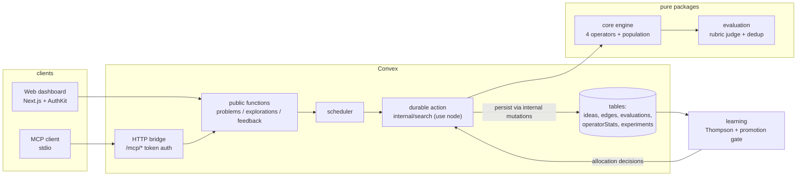

# Architecture

AGHARTA is a pnpm monorepo. All creative-search logic lives in pure, framework-free packages so it can be unit-tested without a database or a real model provider.

## Layout

```text
apps/web          Next.js 16 App Router — dashboard, problems, explorations, lineage, learning, settings
apps/mcp          MCP stdio server (MCP TypeScript SDK v2), 4 tools
convex/           Convex backend: schema, public functions, internal durable actions, HTTP bridge
packages/shared   Zod domain contracts + pure utilities (hashing, similarity, PRNG, budgets)
packages/core     model adapters (real OpenAI via AI SDK 7 + deterministic fake), operators, concepts, population, engine
packages/evaluation  anchored rubrics, judge, dedup, benchmark metrics
packages/learning    Beta-Bernoulli stats, Thompson allocation, credit assignment, challenger/promotion gate
benchmarks/       13 problem briefs (incl. 3 holdouts), multi-mode runner
scripts/          Convex integration journey (live deployment)
```

## Data flow



## Exploration execution (durable, idempotent)

1. `explorations.start` (public mutation) validates membership, picks the current champion strategy, inserts an `explorations` row, and schedules `internal/search:runExplorationAction` after 0ms.
2. The action ('use node') loads context through an internal query, constructs model adapters (`fake` unless `OPENAI_API_KEY` set), and runs the pure engine loop from `packages/core`.
3. Every artifact — ideas, edges, sources, invocations, evaluations — is persisted through dedicated internal mutations (actions cannot use `ctx.db` directly).
4. Finalization is idempotent: the mutation checks terminal status before writing; cancellation is polled between generations and aborts cleanly, keeping partial results.
5. The learning action (`internal/learning:recomputeOperatorStats`) rebuilds `operatorStats` from feedback + invocations (full recomputation, idempotent), and `internal/optimize:runExperiment` runs champion/challenger arms on fixed benchmark problems with matched budgets and seeds, then applies the promotion gate. **Promotion itself is a separate user-confirmed mutation** (`strategies.promote`) — the system never self-promotes.

## Model boundary

`packages/core/models.ts` defines the `ModelAdapter` port (strict `IdeaSchema` output, usage accounting). Two implementations:

- **fake** — deterministic, seeded (mulberry32), free; used by every unit test, the Convex integration journey, and the benchmark report. Its ideas draw from 30 distinct mechanism narratives so similarity/dedup logic is exercised honestly.
- **openai** — Vercel AI SDK 7 `generateText` with `Output.object({ schema })`, retries with jitter, `ModelBoundaryError` classification. Requires `OPENAI_API_KEY` in **Convex env** (not the Next.js env).

Switching is a deployment env var (`AI_PROVIDER`), never a code change.

## Diversity selection

`selectDiverse` in `packages/core/population.ts` greedily maximizes `qualityProxy + diversityWeight * minDistanceToSelected` where distance = 1 − cosine(hashEmbedding(title+mechanism)). One slot is reserved for the highest-distance viable idea so unusual lineages survive. Judge-flagged near-duplicates are dropped before selection.

## Learning loop

- **Stats:** Beta-Bernoulli posteriors per (domain, operator). Success events are *outcome* feedback only (`attempted` → `succeeded`); shortlists update a separate selector model; proxy scores never count as outcomes.
- **Allocation:** Thompson sampling with an exploration floor (10%) so no operator starves.
- **Credit:** exposure-aware — an operator is only debited when it actually got slots, using per-invocation counts.
- **Promotion:** a challenger must beat the champion on the primary metric (qualified-unique ideas) across ≥4 fixed benchmark problems × ≥3 seeds without regressing guardrails, and then a human confirms via `strategies.promote`. Every decision writes a `promotionAudit` row.

## Evidence tiers (strict)

`selectionState` on ideas and `verificationStatus` on mechanisms separate three tiers everywhere (queries, UI chips, charts):

1. `automated_proxy` — judge scores. Cheap, scalable, not truth.
2. `human_selected` — shortlist/reject decisions.
3. `verified_outcome` — attempted with recorded success/failure (+optional evidence text).

The learning loop's outcome stats use tier 3 only. The dashboard Learning page renders per-tier counts side by side and never merges them.

## MCP bridge

`convex/http.ts` exposes `/mcp/{explore_problem,get_exploration,submit_idea_feedback,get_learning_summary}` (POST). Auth: `Authorization: Bearer agt_...` → prefix-indexed lookup → HMAC-SHA256 (keyed by `AGHARTA_TOKEN_HASH_KEY`) → constant-time compare → workspace binding. The stdio server (`apps/mcp`) holds only this personal token — no Convex admin/deploy keys ever reach the client process.
